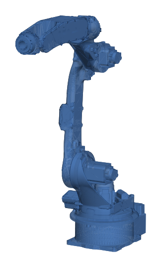

# Yaskawa GP25: Kinematics, Dynamics and Motor-Level Control in Simscape

Cyber-Physical Systems final project · University of Debrecen · 2025/26 spring

I built a digital twin of the **Yaskawa Motoman GP25**, a 6-axis industrial arm with a 25 kg payload and about 1.7 m reach, and took it all the way from CAD to closed-loop control.

**CAD → URDF → kinematics → dynamics → DC motors + gearboxes → six PID loops**

Most class examples drive joints with ideal position commands. I wanted real motors, voltage limits and feedback in the loop, so the model behaves like the physical system.

 

## What's in it

**Forward kinematics.** I set up a DH table from the CAD geometry (d₁ = 0.350 m, a₂ = 0.150 m, a₃ = 0.760 m, a₄ = 0.140 m, d₄ = 0.820 m). The hand-derived T₀⁶ matches MATLAB's `getTransform()` both at home and at a test pose.

**Inverse kinematics.** I used `inverseKinematics()` to reach the target [0.5, 0.3, 1.2] m. Plugging the solution back in returns exactly that point.

**Trajectory.** A 0.2 m-radius circle in the XY plane over 2 s with a smooth (cycloidal) angle profile, so velocity and acceleration start and end at zero. IK is solved at every step.

**Inverse dynamics, and a debugging story.** The first run gave a peak torque of **3,135 Nm** on the shoulder, which made no sense for this robot. The cause was Onshape exporting mass and inertia in lbm and lbm·in², which Simscape then read as SI. After converting all six bodies, the total mass dropped from 467 kg to 191 kg and the shoulder peak came down to **1,066 Nm**.

**Motor-level control.** I replaced the ideal joint actuators with DC motor → gearbox → revolute joint chains (100:1 on J1–J3, 50:1 on J4–J5, 30:1 on J6, ±24 V supply). Each joint got its own PID, tuned one at a time because the inertias differ by orders of magnitude between the shoulder and the wrist. The arm tracks circles, spirals and a short choreographed sequence, and the Simscape torques agree with the MATLAB inverse-dynamics results.

The full write-up, including the DH derivation, tuning notes and plots, is in [`docs/GP25_Final_Report.pdf`](docs/GP25_Final_Report.pdf).

## Files

| File | Purpose |
|---|---|
| `GP255X.m` | Main script: FK, IK, circular trajectory, inverse dynamics |
| `GP255.slx` | Simscape Multibody model with motors, gearboxes and PID loops |
| `GP2552.m` | Re-imports the assembly from Onshape (`smexportonshape` → `smimport`) |
| `GP251.xml`, `GP251_DataFile.m`, `GP25_DataFile.m` | Simscape import description and body parameters |
| `_*_AXIS_*.step` | Link geometry (S, L, U, R, B, T axes and base) used by the model |

CAD source: [Onshape document](https://cad.onshape.com/documents/08b071bf0234bff7ace22b17/w/4c3e73d7dddde8733aaab38a/e/aab74ebe8122bfda9ac3ac4f)

## Running it

MATLAB R2024b or newer with Simulink, Simscape, Simscape Multibody, Simscape Electrical and Robotics System Toolbox. Keep the STEP files in the same folder as the model. Run `GP255X.m`, then open `GP255.slx`.

---
Part of [Mohammed Emad's engineering portfolio](https://github.com/Mohammed-Emad-2004).
